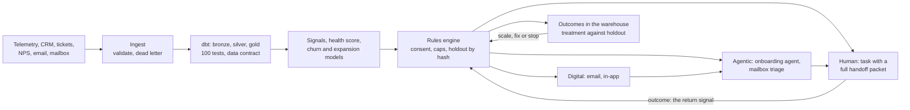
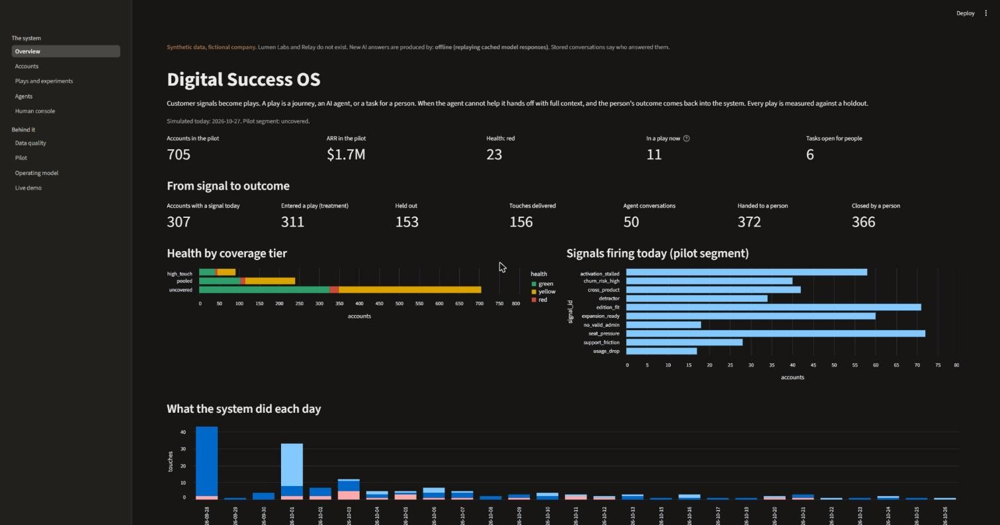
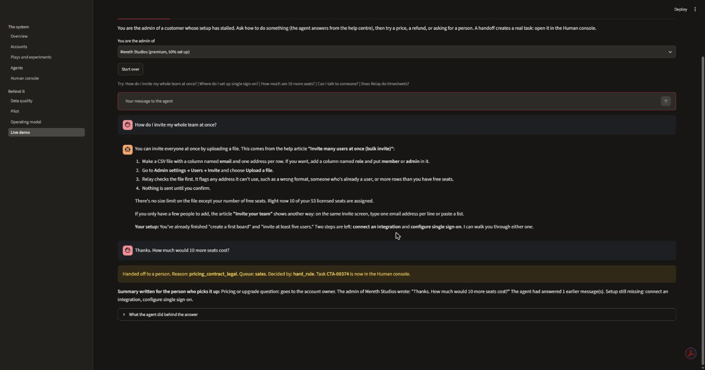
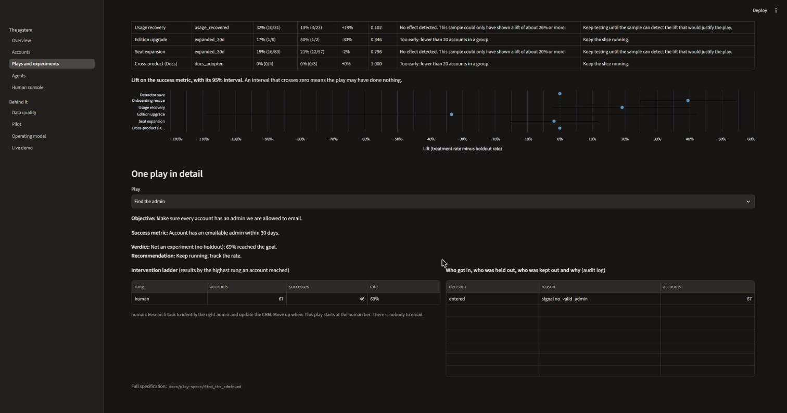

# Digital Success OS (mini)

[](https://github.com/pablopayet3/digital-success-os/actions/workflows/ci.yml)

> **Synthetic data, fictional company.** "Lumen Labs" and its product "Relay" do not exist.
> Every account, contact, event and message in this repository is generated.

**Customer signals → plays → AI agents → human fallback → measured against a holdout.**

A small, working version of a digital customer-success operating system. Raw product
telemetry and CRM data land in a pipeline, are cleaned into production tables with
data-quality tests, become signals and model scores, and trigger plays: a journey, an AI
agent, or a task for a person. When the agent cannot help, it hands off with full
context, and the person's outcome comes back into the system. Every play has a holdout,
so the system can show what it actually moved.



## What it looks like

The loop on one page: signals, plays, touches, agent conversations, handoffs, outcomes.



The onboarding agent answers a setup question from the help centre, naming the article
and the account's own setup status. The next message asks for a price: a rule in code
hands it to Sales before the model is asked, and a task with full context is created.



Every play against its holdout: the lift with its 95% interval, and a verdict from a
written rule. An interval that crosses zero is reported as not proven.



## What a clean run produces

From `uv run python run.py demo` (180 days of history, then 30 simulated days of the pilot):

| | |
|---|---|
| Accounts generated / active today | 1,200 / 1,036 (705 in the pilot segment) |
| Product events kept / rejected with a reason | 617,555 / 8,385 |
| Data tests / contract checks passing | 100 of 100 / 14 of 14 |
| Plays live, each with an owner, a metric and a holdout | 7 |
| Decisions logged with a reason (entered, held out, excluded) | 3,740 |
| Tasks handed to people, each with a handoff packet | 372 |
| Agent conversations with the real model / handed off | 50 / 13 (26%) |
| Mailbox replies read and routed | 613 (37 old buying questions and 37 old complaints had gone unread before the agent existed) |
| Onboarding rescue: setup completed, treatment against holdout | 41% (19 of 46) against 2% (1 of 55): **+39 points**, 95% interval +25 to +54 |
| Usage recovery: usage back to 90%, treatment against holdout | 32% against 13%: +19 points, p = 0.10: **not yet proven, keep testing** |
| Seat expansion: expansion closed, treatment against holdout | 19% against 21%: **no effect detected** (the sample could only have shown 20 points or more) |
| Agent evaluation, real model, 44 cases | Onboarding agent 30 of 30 with prompt v3 (v1: 29, v2: 25); mailbox 10 of 10; briefs 4 of 4; classifier 96% on 160 labelled replies |
| Cost of every real model call behind this (817 calls) | about $3 |
| Automated tests | 155 |

Three honest notes. The lift comes from assumptions in `config/sim_effects.yaml`: this
demonstrates a measurement system, not a result. The agent answers are real: one live
run produced every conversation, classification, brief and evaluation shown here, and
the responses are stored in `cache/llm/`, so everything replays offline with no key
(ADR 0015). And that first live run found a real bug in the agent and three faults in
the evaluation harness that the stand-in could never have shown (ADR 0017).

## See it without installing anything

- **The app:** https://digital-success-os-app.onrender.com (free hosting: the first load can take a minute; it runs the labelled stand-in, not the real model)
- **The API:** https://digital-success-os-api.onrender.com/health
- **The dashboard:** [Digital Success pilot on Tableau Public](https://public.tableau.com/views/DigitalSuccesspilotsyntheticdata/DigitalSuccesspilot_Syntheticdatafictionalcompany)

## Run it in 60 seconds

Needs [uv](https://docs.astral.sh/uv/). Python 3.12 is installed by uv.

```
uv sync
uv run python run.py demo 10 --profile small --stand-in   # a small world, about 3 minutes
uv run python run.py app --stand-in                       # http://localhost:8501
```

The full build is `uv run python run.py demo` (about 15 minutes). It replays the real
model responses stored in `cache/llm/`, so it needs no key and no network.

**Who answers as the model** is a switch on any command:

| Switch | Answers come from | Needs |
|---|---|---|
| (none) | Real model responses replayed from `cache/llm/`. Anything not cached is handed to a person | Nothing |
| `--live` | The cache first, then the API, up to a budget that stops the run | A key in `.env` |
| `--stand-in` | Keyword rules, labelled as a stand-in on every screen | Nothing |

| Command | What it does |
|---|---|
| `run.py data` | Generate the synthetic world |
| `run.py pipeline` | Ingest, dbt build and tests, score, freshness, contract check |
| `run.py train` | Train the churn and expansion models |
| `run.py run-days 30` | Simulate days: world, pipeline, staff, mailbox, rules, journeys |
| `run.py experiments` | Every play against its holdout: `experiments/reports/` |
| `run.py evals` | Score the agents on the fixed cases: `evals/reports/` |
| `run.py review` | Write the monthly operating review from the data: `docs/operating-review.md` |
| `run.py extracts` | Write the gold tables as files for a BI tool: `exports/bi/` |
| `run.py crm-sync` | Dry run of the CRM sync: writes what would be sent. `--push` sends it |
| `run.py specs` | Rebuild the play specs from the configuration |
| `run.py app` / `run.py api` | The app (port 8501) / the API (port 8000, `/docs`) |
| `run.py test` / `run.py lint` | Tests and style |

On Windows, keep the project in a short folder path. Deeply nested folders push dbt's
file names past the 260-character limit.

## What is in the app

| Page | What it shows |
|---|---|
| Overview | The loop in numbers: signals, plays, touches, conversations, handoffs, outcomes |
| Accounts | One account: health and why, signals with evidence, scores with reasons, everything the system did and every decision not to act |
| Plays and experiments | The play catalog; each play against its holdout with an interval and a verdict; results per ladder rung; the audit log |
| Agents | Conversations with tool calls and retrieval; mailbox triage; the evaluation report; the prompt changelog |
| Human console | Sign in by role, work a queue, open a handoff packet, resolve it: the return signal |
| Data quality | What was rejected and why, test results, freshness, the data contract |
| Pilot | Rollout stage per play, results per rung, how the pattern scales |
| Operating model | Ownership, change control, principles, play specs, decision records |
| Live demo | Talk to the agent and watch it hand off; advance the world one day |

## Coverage map: what the role asks for, and where it is here

| The role asks for | What is built | Where |
|---|---|---|
| Build a digital success operating system; pilot uncovered accounts, then scale the pattern | Config-driven engine; pilot on the `uncovered` segment; 10% slice, then a full test with a holdout; readiness checklist; scale, fix or stop per play; one line of config extends to `pooled` | `config/rollout.yaml`, `engine/`, `docs/pilot-plan.md`, Pilot page |
| Digital, agentic and human interventions | Every play declares its ladder and the rule for moving up; results per rung | `config/plays.yaml`, `gold.metrics_play_ladder` |
| Requirements for clean account, contact, product, engagement, lifecycle and health data | A spec for the six areas, written backwards from the plays | `docs/data-requirements.md` |
| Partner with agent engineers and data science | One spec per play, generated from the config so it cannot drift; model cards | `docs/play-specs/`, `docs/model-cards/` |
| Turn telemetry, lifecycle, health, engagement, sentiment, support and commercial signals into plays, triggers, tasks and handoffs | Signals table, play catalog as configuration, rules engine | `dbt/models/marts/signals.sql`, `config/plays.yaml`, `engine/rules.py` |
| Close ownership gaps as the accountable owner | RACI for every table, model, play, agent and queue, with gaps and proposed owners | `docs/ownership-map.md` |
| Protect delivery momentum | Decision records, principles, dependency map, change control with a PR template | `docs/decisions/`, `docs/principles.md`, `docs/dependency-map.md`, `docs/change-control.md` |
| Data foundation and pipelines | Landing zone, validated ingest with a dead letter, bronze, silver, gold, contact tagging | `ingest/`, `dbt/` |
| Data engineering fluency | ELT in dbt, tests and freshness, a data contract checked by code, export endpoints, an events endpoint | `dbt/`, `contracts/`, `api/` |
| Analytics and modelling | Exploratory analysis, segmentation, churn and expansion models with an honest comparison | `analytics/`, `docs/eda-report.md` |
| Measurement design | Every metric defined once, with its table | `docs/metrics.md`, `dbt/models/marts/metrics_*.sql` |
| Sentiment and text analysis | Intent, sentiment and confidence for NPS comments, tickets and replies | `agents/classify.py`, `agents/feedback.py` |
| Agent signal design: plays, prompts, retrieval, escalation, feedback loops | Onboarding agent with tools and retrieval, versioned prompts, escalation rules in code, a review queue | `agents/`, `prompts/` |
| Model evaluation and human-in-the-loop feedback | Fixed cases, code checks first and a judge second, prompt versions compared, unnecessary handoffs become cases | `evals/` |
| Rules engines | Audience rules, exclusions, priorities, exclusivity, every decision logged | `engine/rules.py` |
| Journey orchestration, tasks, shared mailbox, consent, channel triggers | Journey runner with waits, branches and goals; tasks with packets; mailbox triage; consent and frequency caps | `engine/journeys.py`, `agents/mailbox.py`, `engine/consent.py` |
| Digital-to-human handoffs: what context moves, what signal returns | Typed handoff packet, queues with SLAs, human console, outcomes that steer the journey | `engine/handoff.py`, `docs/human-fallback.md` |
| Experimentation: cohorts, tests, operating reviews | Holdout by hash, two-proportion test with an interval, split check, cohorts, a written decision rule | `experiments/` |
| Human fallback engineering | Tool failure, an unavailable model and "not in the docs" all hand off; handoff-quality metrics | `agents/onboarding.py`, `gold.metrics_handoffs` |
| Product mindset | PRD, roadmap, prompt changelog, play catalog with owners and metrics | `docs/prd.md`, `docs/roadmap.md`, `prompts/CHANGELOG.md` |
| Success and sales mindset | An expansion play that hands a seller a brief checked against the data; retained revenue and expansion against the holdout | `agents/briefs.py`, `experiments/` |

## Tool mapping

This is the only place, with `docs/production-architecture.md` and the demo script, where
real product names appear. They name the category of tool; nothing here uses their
branding or data.

| Enterprise tool in a role like this | Concept | What this demo uses |
|---|---|---|
| Databricks / SQL | Medallion lakehouse, ELT, production tables | DuckDB and dbt (bronze, silver, gold) locally; the same models run on a Databricks Free Edition workspace with `DSO_ENV=prod` |
| Gainsight Journey Orchestrator | Audience rules, steps, branches, exits | `config/journeys.yaml` and the journey runner |
| Gainsight CTAs and Cockpit | Tasks for people, with playbooks | The `ctas` table and the Human console |
| Salesforce | Accounts, contacts, opportunities, owners | Synthetic CRM tables, export endpoints, and a sync that writes health and open tasks to standard Account and Task objects (`integrations/crm_sync.py`) |
| Tableau | Dashboards | Streamlit on the gold tables, and a [published Tableau Public dashboard](https://public.tableau.com/views/DigitalSuccesspilotsyntheticdata/DigitalSuccesspilot_Syntheticdatafictionalcompany) built from the same tables (`docs/bi-dashboard-guide.md`) |
| Shared mailbox | Replies to digital journeys | Mailbox triage agent and routing rules |
| The company's own AI agents | Agents with tools and retrieval | Claude with tool use, and keyword retrieval over a help centre |

## How this maps to the real job

In a real role this is not one application. It is seven kinds of deliverable spread
across existing platforms. This repository compresses them into one system to show how
they connect.

| Deliverable in the real job | Where it would live | Where it lives here |
|---|---|---|
| Data requirements and production tables | Specs in Confluence; tables built by Data Engineering in Databricks | `docs/data-requirements.md`, `dbt/` |
| Signals and scores | Databricks tables; Gainsight health | `dbt/models/marts/signals.sql`, `analytics/` |
| Journeys and tasks | Gainsight Journey Orchestrator and Cockpit | `config/journeys.yaml`, `engine/` |
| Agent plays | Built with CS AI agent engineers | `agents/`, `docs/play-specs/` |
| Handoff workflows | CTAs and shared-mailbox workflows | `engine/handoff.py`, `agents/mailbox.py` |
| Measurement | Tableau; experiments with Analytics | `experiments/`, `app/` |
| Operating documents | Confluence and Jira | `docs/`, including a generated monthly review (`docs/operating-review.md`) |

Why there is a mailbox agent: replies to journey emails land in a shared mailbox, and as
far as I could tell from the vendor's community forum, reading and routing those replies
is not covered out of the box by the journey tool. That is an assumption to confirm, not
a fact I have verified. If it holds, an unsubscribe or a buying question can sit unread,
which is the gap the triage agent closes.

## Design decisions

Nineteen decision records in [docs/decisions](docs/decisions/), each with context,
options, the decision, consequences and when to revisit. The ones worth reading first:

| Decision | Record |
|---|---|
| Escalation rules are code, not prompt | 0003 |
| Flag accounts by team capacity, not by a fixed score | 0004 |
| A simulated world that reacts to touches, and what that does and does not prove | 0005 |
| A data contract checked in both directions | 0010 |
| Plays as configuration, holdouts by hash | 0014 |
| LLM cost controls, and the labelled stand-in | 0015 |
| A 50% holdout and leading indicators for the pilot; what happened when the split check fired | 0016 |
| Evals: code checks first, judge second; what the first real-model run taught | 0017 |

What each phase delivered, and three decisions to defend for each, is in
[docs/phase-notes.md](docs/phase-notes.md).

## What runs for real, and what has not been run yet

Running on GitHub Actions: CI on every push (lint, 155 tests on Linux, the dbt build, a
secret scan), the container image build (it generates a demo world inside the image and
publishes it), and the daily pipeline schedule, which opens an issue when a run fails.

Run against a real Databricks Free Edition workspace: the whole pipeline with
`DSO_ENV=prod`. The same dbt models passed 100 of 100 data tests there with no change,
the contract passed, and the results match the local warehouse (ADR 0012). Sign-in is
through the browser, so no access token is stored.

Run on a real Postgres on every push: the operational store. CI starts a Postgres
service, runs the same store tests as on SQLite, and runs the engine for three simulated
days with its live state there (ADR 0013). The hosted app and API share a hosted
Postgres database as their store; the API's `/health` says which store is in use.

Written but not yet run against the real thing. Each needs an account or a key.

| What | Needs |
|---|---|
| Trace export | A tracing key (JSON traces work without one) |
| The live CRM push | A Salesforce Developer Edition org and its credentials (the dry run and the tests are verified) |

## What I would do differently at scale

Streaming ingestion for signals that cannot wait a day. A feature store, so models and
plays share definitions. Embedding retrieval with re-ranking once the help centre
outgrows keyword search. A real experimentation platform with sequential tests and a
90-day revenue read. Reverse-ETL tooling for the CRM and CS-platform sync. A governance
review before any agent talks to a customer. More in
[docs/production-architecture.md](docs/production-architecture.md).

## Layout

```
config/       plays, journeys, routing, rollout, health weights, models, LLM roles, environments
synth/        the world simulator (the only code that knows the hidden truth)
ingest/       validation, dead letter, bronze loads, dbt runner
dbt/          silver and gold models, tests, macros for portable SQL
contracts/    the data contract for the production table, and its checker
analytics/    features, training, scoring, model cards, exploratory analysis
engine/       rules, journeys, consent, handoffs, the daily loop, play specs
agents/       LLM client with cost controls, onboarding agent, mailbox triage, briefs
prompts/ kb/  versioned prompts with a changelog; 23 fictional help articles
evals/        evaluation cases, runner and reports
experiments/  play results against holdouts
api/ app/     FastAPI endpoints; the Streamlit app
integrations/ the CRM sync
docs/         operating documents, decision records, play specs, model cards
tests/        155 tests; they generate a small world and run everything on it
```