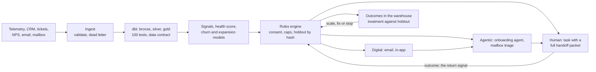

# Digital Success OS (mini)

> **Synthetic data, fictional company.** "Lumen Labs" and its product "Relay" do not exist.
> Every account, contact, event and message in this repository is generated.

**Customer signals → plays → AI agents → human fallback → measured against a holdout.**

A small, working version of a digital customer-success operating system. Raw product
telemetry and CRM data land in a pipeline, are cleaned into production tables with
data-quality tests, become signals and model scores, and trigger plays: a journey, an AI
agent, or a task for a person. When the agent cannot help, it hands off with full
context, and the person's outcome comes back into the system. Every play has a holdout,
so the system can show what it actually moved.



## What a clean run produces

From `uv run python run.py demo` (180 days of history, then 30 simulated days of the pilot):

| | |
|---|---|
| Accounts generated / active today | 1,200 / 1,038 (709 in the pilot segment) |
| Product events kept / rejected with a reason | 617,001 / 8,388 |
| Data tests / contract checks passing | 100 of 100 / 14 of 14 |
| Plays live, each with an owner, a metric and a holdout | 7 |
| Decisions logged with a reason (entered, held out, excluded) | 3,755 |
| Tasks handed to people, each with a handoff packet | 388 |
| Agent conversations / handed off | 52 / 20 (38%) |
| Mailbox replies read and routed | 584 |
| Onboarding rescue: setup completed, treatment against holdout | 35% (17 of 49) against 0% (0 of 50): **+35 points**, 95% interval +21 to +48 |
| Seat expansion: expansion closed, treatment against holdout | 23% against 10%: +13 points, p = 0.054: **not yet proven, keep testing** |
| Evaluation cases for the agents | 44 |
| Automated tests | 138 |

Two honest notes. The lift comes from assumptions in `config/sim_effects.yaml`: this
demonstrates a measurement system, not a result. And the agent answers in this run come
from a labelled rule-based stand-in; one run with an API key replaces them with real
model responses, which are then cached and replayed offline (see ADR 0015).

## Run it in 60 seconds

Needs [uv](https://docs.astral.sh/uv/). Python 3.12 is installed by uv.

```
uv sync
uv run python run.py demo 10 --profile small   # a small world, about 3 minutes
uv run python run.py app                       # http://localhost:8501
```

The full build is `uv run python run.py demo` (about 15 minutes). Everything runs offline:
no key, no network.

| Command | What it does |
|---|---|
| `run.py data` | Generate the synthetic world |
| `run.py pipeline` | Ingest, dbt build and tests, score, freshness, contract check |
| `run.py train` | Train the churn and expansion models |
| `run.py run-days 30` | Simulate days: world, pipeline, staff, mailbox, rules, journeys |
| `run.py experiments` | Every play against its holdout: `experiments/reports/` |
| `run.py evals` | Score the agents on the fixed cases: `evals/reports/` |
| `run.py specs` | Rebuild the play specs from the configuration |
| `run.py app` / `run.py api` | The app (port 8501) / the API (port 8000, `/docs`) |
| `run.py test` / `run.py lint` | Tests and style |

On Windows, keep the project in a short folder path. Deeply nested folders push dbt's
file names past the 260-character limit.

## What is in the app

| Page | What it shows |
|---|---|
| Overview | The loop in numbers: signals, plays, touches, conversations, handoffs, outcomes |
| Accounts | One account: health and why, signals with evidence, scores with reasons, everything the system did and every decision not to act |
| Plays and experiments | The play catalog; each play against its holdout with an interval and a verdict; results per ladder rung; the audit log |
| Agents | Conversations with tool calls and retrieval; mailbox triage; the evaluation report; the prompt changelog |
| Human console | Sign in by role, work a queue, open a handoff packet, resolve it: the return signal |
| Data quality | What was rejected and why, test results, freshness, the data contract |
| Pilot | Rollout stage per play, results per rung, how the pattern scales |
| Operating model | Ownership, change control, principles, play specs, decision records |
| Live demo | Talk to the agent and watch it hand off; advance the world one day |

## Coverage map: what the role asks for, and where it is here

| The role asks for | What is built | Where |
|---|---|---|
| Build a digital success operating system; pilot uncovered accounts, then scale the pattern | Config-driven engine; pilot on the `uncovered` segment; 10% slice, then a full test with a holdout; readiness checklist; scale, fix or stop per play; one line of config extends to `pooled` | `config/rollout.yaml`, `engine/`, `docs/pilot-plan.md`, Pilot page |
| Digital, agentic and human interventions | Every play declares its ladder and the rule for moving up; results per rung | `config/plays.yaml`, `gold.metrics_play_ladder` |
| Requirements for clean account, contact, product, engagement, lifecycle and health data | A spec for the six areas, written backwards from the plays | `docs/data-requirements.md` |
| Partner with agent engineers and data science | One spec per play, generated from the config so it cannot drift; model cards | `docs/play-specs/`, `docs/model-cards/` |
| Turn telemetry, lifecycle, health, engagement, sentiment, support and commercial signals into plays, triggers, tasks and handoffs | Signals table, play catalog as configuration, rules engine | `dbt/models/marts/signals.sql`, `config/plays.yaml`, `engine/rules.py` |
| Close ownership gaps as the accountable owner | RACI for every table, model, play, agent and queue, with gaps and proposed owners | `docs/ownership-map.md` |
| Protect delivery momentum | Decision records, principles, dependency map, change control with a PR template | `docs/decisions/`, `docs/principles.md`, `docs/dependency-map.md`, `docs/change-control.md` |
| Data foundation and pipelines | Landing zone, validated ingest with a dead letter, bronze, silver, gold, contact tagging | `ingest/`, `dbt/` |
| Data engineering fluency | ELT in dbt, tests and freshness, a data contract checked by code, export endpoints, an events endpoint | `dbt/`, `contracts/`, `api/` |
| Analytics and modelling | Exploratory analysis, segmentation, churn and expansion models with an honest comparison | `analytics/`, `docs/eda-report.md` |
| Measurement design | Every metric defined once, with its table | `docs/metrics.md`, `dbt/models/marts/metrics_*.sql` |
| Sentiment and text analysis | Intent, sentiment and confidence for NPS comments, tickets and replies | `agents/classify.py`, `agents/feedback.py` |
| Agent signal design: plays, prompts, retrieval, escalation, feedback loops | Onboarding agent with tools and retrieval, versioned prompts, escalation rules in code, a review queue | `agents/`, `prompts/` |
| Model evaluation and human-in-the-loop feedback | Fixed cases, code checks first and a judge second, prompt versions compared, unnecessary handoffs become cases | `evals/` |
| Rules engines | Audience rules, exclusions, priorities, exclusivity, every decision logged | `engine/rules.py` |
| Journey orchestration, tasks, shared mailbox, consent, channel triggers | Journey runner with waits, branches and goals; tasks with packets; mailbox triage; consent and frequency caps | `engine/journeys.py`, `agents/mailbox.py`, `engine/consent.py` |
| Digital-to-human handoffs: what context moves, what signal returns | Typed handoff packet, queues with SLAs, human console, outcomes that steer the journey | `engine/handoff.py`, `docs/human-fallback.md` |
| Experimentation: cohorts, tests, operating reviews | Holdout by hash, two-proportion test with an interval, split check, cohorts, a written decision rule | `experiments/` |
| Human fallback engineering | Tool failure, an unavailable model and "not in the docs" all hand off; handoff-quality metrics | `agents/onboarding.py`, `gold.metrics_handoffs` |
| Product mindset | PRD, roadmap, prompt changelog, play catalog with owners and metrics | `docs/prd.md`, `docs/roadmap.md`, `prompts/CHANGELOG.md` |
| Success and sales mindset | An expansion play that hands a seller a brief checked against the data; retained revenue and expansion against the holdout | `agents/briefs.py`, `experiments/` |

## Tool mapping

This is the only place, with `docs/production-architecture.md` and the demo script, where
real product names appear. They name the category of tool; nothing here uses their
branding or data.

| Enterprise tool in a role like this | Concept | What this demo uses |
|---|---|---|
| Databricks / SQL | Medallion lakehouse, ELT, production tables | DuckDB and dbt (bronze, silver, gold); a `prod` dbt target for Databricks |
| Gainsight Journey Orchestrator | Audience rules, steps, branches, exits | `config/journeys.yaml` and the journey runner |
| Gainsight CTAs and Cockpit | Tasks for people, with playbooks | The `ctas` table and the Human console |
| Salesforce | Accounts, contacts, opportunities, owners | Synthetic CRM tables and export endpoints |
| Tableau | Dashboards | Streamlit on the gold tables |
| Shared mailbox | Replies to digital journeys | Mailbox triage agent and routing rules |
| The company's own AI agents | Agents with tools and retrieval | Claude with tool use, and keyword retrieval over a help centre |

## How this maps to the real job

In a real role this is not one application. It is seven kinds of deliverable spread
across existing platforms. This repository compresses them into one system to show how
they connect.

| Deliverable in the real job | Where it would live | Where it lives here |
|---|---|---|
| Data requirements and production tables | Specs in Confluence; tables built by Data Engineering in Databricks | `docs/data-requirements.md`, `dbt/` |
| Signals and scores | Databricks tables; Gainsight health | `dbt/models/marts/signals.sql`, `analytics/` |
| Journeys and tasks | Gainsight Journey Orchestrator and Cockpit | `config/journeys.yaml`, `engine/` |
| Agent plays | Built with CS AI agent engineers | `agents/`, `docs/play-specs/` |
| Handoff workflows | CTAs and shared-mailbox workflows | `engine/handoff.py`, `agents/mailbox.py` |
| Measurement | Tableau; experiments with Analytics | `experiments/`, `app/` |
| Operating documents | Confluence and Jira | `docs/` |

Why there is a mailbox agent: replies to journey emails land in a shared mailbox, and as
far as I could tell from the vendor's community forum, reading and routing those replies
is not covered out of the box by the journey tool. That is an assumption to confirm, not
a fact I have verified. If it holds, an unsubscribe or a buying question can sit unread,
which is the gap the triage agent closes.

## Design decisions

Eighteen decision records in [docs/decisions](docs/decisions/), each with context,
options, the decision, consequences and when to revisit. The ones worth reading first:

| Decision | Record |
|---|---|
| Escalation rules are code, not prompt | 0003 |
| Flag accounts by team capacity, not by a fixed score | 0004 |
| A simulated world that reacts to touches, and what that does and does not prove | 0005 |
| A data contract checked in both directions | 0010 |
| Plays as configuration, holdouts by hash | 0014 |
| LLM cost controls, and the labelled stand-in | 0015 |
| A 50% holdout and leading indicators for the pilot; what happened when the split check fired | 0016 |
| Evals: code checks first, judge second | 0017 |

What each phase delivered, and three decisions to defend for each, is in
[docs/phase-notes.md](docs/phase-notes.md).

## Not yet run against real services

The code for these is written and tested locally, but has not been run against the real
thing. Each needs an account or a key.

| What | Needs |
|---|---|
| Real model responses for the agents, the judge and the prompt comparison | An API key, one live run (stops at a $5 budget) |
| Databricks as the `prod` warehouse | A workspace host, SQL warehouse path and token |
| Postgres operational store | A database URL |
| CI, image build, daily schedule | A GitHub repository |
| Hosted app and API | A host connected to the repository; Docker to build locally |
| Trace export | A tracing key (JSON traces work without one) |

## What I would do differently at scale

Streaming ingestion for signals that cannot wait a day. A feature store, so models and
plays share definitions. Embedding retrieval with re-ranking once the help centre
outgrows keyword search. A real experimentation platform with sequential tests and a
90-day revenue read. Reverse-ETL tooling for the CRM and CS-platform sync. A governance
review before any agent talks to a customer. More in
[docs/production-architecture.md](docs/production-architecture.md).

## Layout

```
config/       plays, journeys, routing, rollout, health weights, models, LLM roles, environments
synth/        the world simulator (the only code that knows the hidden truth)
ingest/       validation, dead letter, bronze loads, dbt runner
dbt/          silver and gold models, tests, macros for portable SQL
contracts/    the data contract for the production table, and its checker
analytics/    features, training, scoring, model cards, exploratory analysis
engine/       rules, journeys, consent, handoffs, the daily loop, play specs
agents/       LLM client with cost controls, onboarding agent, mailbox triage, briefs
prompts/ kb/  versioned prompts with a changelog; 23 fictional help articles
evals/        evaluation cases, runner and reports
experiments/  play results against holdouts
api/ app/     FastAPI endpoints; the Streamlit app
docs/         operating documents, decision records, play specs, model cards
tests/        138 tests; they generate a small world and run everything on it
```