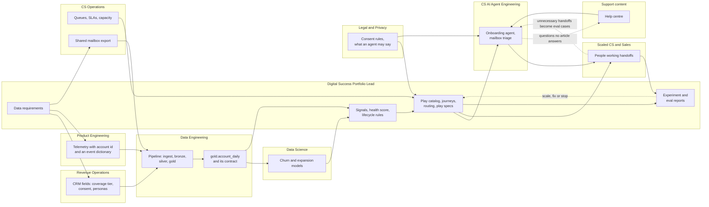

# Dependency map

Synthetic data, fictional company. Which workstream waits for which, and which team owns
it. An arrow means "must exist before". The dashed arrows are the feedback loops.

## What blocks what

| Blocked | Waits for | Owner of the blocker | Unblock by |
|---|---|---|---|
| Selecting the pilot segment | An explicit coverage tier in the CRM | RevOps | A field and a backfill rule |
| Sending any journey email | One consent field with one owner | RevOps, Privacy | Agreeing the field and who may change it |
| Setup and usage signals | Account id on every event; agreed event names | Product Engineering | The event dictionary |
| Every play, model and dashboard | `gold.account_daily` built to its contract | Data Engineering | The data requirements and the contract |
| Model-driven plays | Churn and expansion scores with reasons | Data Science | The outcome labels and a capacity number |
| The onboarding agent | Help-centre articles for the setup steps; the rules on what an agent may say | Support content, Privacy | The play spec |
| Any human step | A queue with an owner, an SLA and capacity | CS Operations, Sales | The routing config |
| Reading replies | A daily export of the shared mailbox | CS Operations | An owner for the mailbox |
| A scale decision | Six to eight weeks of results against a holdout | Digital Success Portfolio Lead | The experiment report |

## The critical path

Coverage tier and consent in the CRM, then the production table, then signals, then the
first play on a slice. Everything else can run in parallel behind those four.