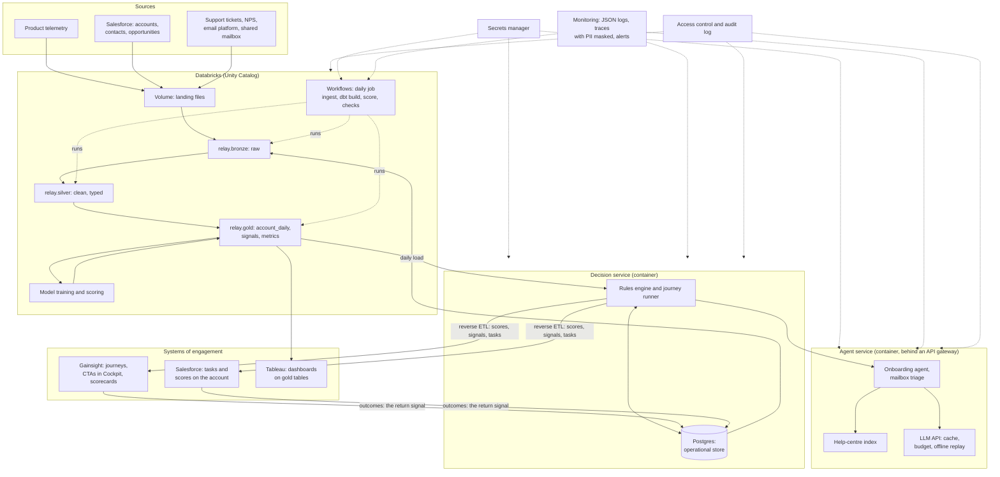

# Production architecture: how this would run at enterprise scale

Synthetic data, fictional company. This page names real platforms, because it describes
where each part of the demo would live in a company that uses them. Nothing in the demo's
data, code or screens uses a real company's name.

The demo has two environments with the same code and the same dbt models: `dev` (a
laptop: DuckDB, SQLite, no network) and `prod` (real services). `DSO_ENV` selects one.

## The picture

## How each concern is handled

| Concern | At scale | In this repository |
|---|---|---|
| Storage and governance | Unity Catalog: `relay.bronze`, `relay.silver`, `relay.gold`; landing files in a volume; table and column permissions | The same three schemas in DuckDB; a `prod` dbt target and a loader for Databricks (`ingest/load_databricks.py`) |
| Transformation | dbt on a SQL warehouse; portable SQL | The same dbt project; no database-specific functions in models (`dbt/macros/portable.sql`) |
| Scheduling | A Databricks Workflows job, with retries and alerts | A daily GitHub Actions workflow; see ADR 0018 for why |
| Data quality | Tests and freshness in the job; a contract on the production table; alerts to the owning team | 100 dbt tests, freshness, `contracts/account_daily.yaml`, all blocking |
| Decisions | A small service that reads gold tables and writes to an operational database | `engine/`, with SQLAlchemy over SQLite or Postgres |
| Engagement | Journeys and tasks run in Gainsight; scores and tasks synced to Salesforce by reverse ETL | A journey runner, an outbox folder, a human console; export endpoints in the shapes those tools import |
| Agents | A containerised service behind an API gateway; rate limits; keys in a secrets manager | `agents/`, a Dockerfile, keys from environment variables only |
| Cost | Budgets per service and per run; caching | `agents/llm.py`: cache, call and budget limits, offline replay |
| Observability | Structured logs, traces, dashboards, on-call alerts | JSON logs (`common/logs.py`), one trace per conversation with PII masked, `/health` |
| Access | Single sign-on and roles; least privilege | Three console roles with passwords from environment variables |
| PII | Minimise, mask in logs and traces, honour consent and deletion | Names and emails masked in traces; consent enforced by the engine; opt-outs same day |
| Audit | Every automated decision recorded with its reason | `audit_log`, handoff packets, conversation records |
| Change | Reviewed changes, staged rollout, rollback | `docs/change-control.md`, slices, play versions |

## What is real in this demo, and what is simulated

| Part | Status | Why |
|---|---|---|
| Customers, telemetry, CRM, tickets, NPS, mailbox | **Simulated** | A generator with hidden traits and deliberate data problems. No real customer data could be used. |
| Customer reactions to touches | **Simulated** | Assumed effect sizes in `config/sim_effects.yaml`. Any lift in the report comes from there. |
| Staff working the queues | **Simulated** in the daily run; **real** in the Human console | A person can pick up and resolve any task in the app. |
| Pipeline, tests, contract, dead letter | **Real** | It runs on every pipeline run and fails the run when a check fails. |
| Models | **Real** | Trained on the generated data with a time-based split; honest metrics in the model cards. |
| Rules engine, journeys, consent, holdouts, handoffs | **Real** | Deterministic code with tests. |
| Experiment statistics | **Real** method, simulated outcomes | The method is what carries over. |
| Agent answers | **Stand-in** until one live run | Rule-based and labelled as such. With an API key, real model responses are cached and replayed offline. |
| Emails | **Not sent** | Written to an outbox folder. |
| Databricks warehouse | **Real** | The whole pipeline ran on a Free Edition workspace: 100 of 100 data tests and the contract pass, and the numbers match DuckDB (ADR 0012). |
| Postgres operational store | **Real, in CI** | Every push runs the store tests and three simulated days of the engine on a Postgres service. A hosted Postgres has not been connected. |
| CRM and CS platform sync | **Export only** | Endpoints return import-ready shapes. No live sync. |
| CI, image build, daily scheduled run | **Real** | They run on GitHub Actions: tests on every push, an image with a demo world built in, a daily pipeline run that opens an issue on failure. |
| Hosting | **Real** | The app and the API run on a free host from the repository's blueprint, in stand-in mode. |
| Dashboards | **Streamlit** instead of a BI tool | One process, no licence. The gold tables are the interface a BI tool would read. |

## What I would do differently at scale

- **Streaming ingestion** for signals that cannot wait a day (a complaint, a failed payment), with the daily batch kept for everything else.
- **A feature store**, so models and plays read the same definitions at training and at decision time.
- **Embedding retrieval with re-ranking**, with keyword search kept as the first stage.
- **An experimentation platform**: sequential testing, variance reduction, a 90-day revenue read.
- **Reverse ETL tooling** for the CRM and CS platform sync, rather than custom exports.
- **A governance review** before any agent talks to customers: what it may say, what it logs, how consent and deletion requests are honoured.